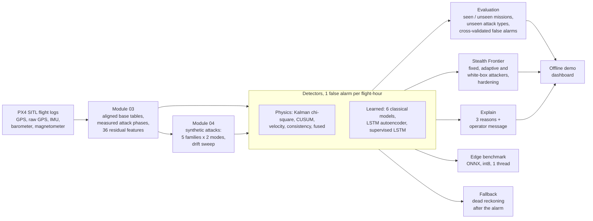
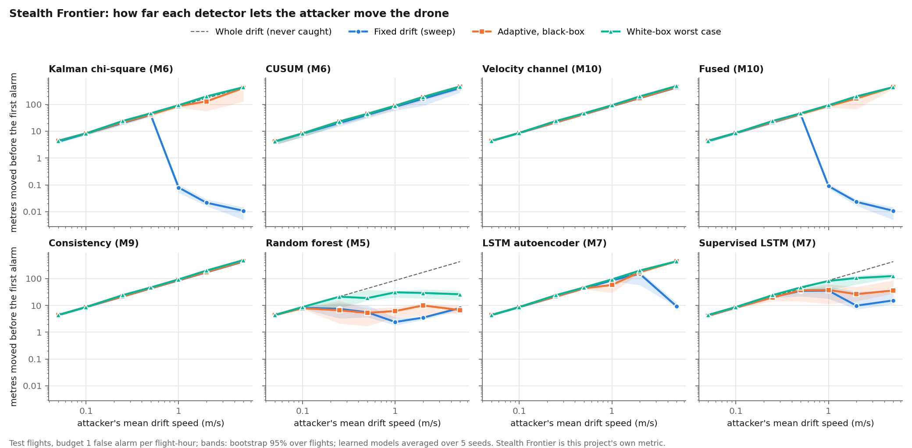

# AEROVIGIL

### Intelligent UAV Navigation Integrity Monitoring and Adaptive GPS Spoofing Detection

## The problem

A small drone trusts its GPS receiver to know where it is. A GPS spoofer broadcasts fake
satellite signals, and a careful one moves the reported position slowly enough that
the autopilot follows it without noticing: the drone is steered somewhere else while
every check looks normal. AEROVIGIL asks three questions on logged flights:

1. **Can it be detected?** Physics-based checks (a Kalman filter fed by the IMU and
   barometer, sensor-consistency tests) are compared with classical machine learning
   and LSTM models on the same flights, at the same false-alarm budget.
2. **How far can a smart attacker get?** Each detector is attacked by an adaptive
   (black-box) and a white-box attacker, and scored on the **Stealth Frontier**: how
   many metres the drone is moved before the first alarm.
3. **What then?** Every alarm is explained in plain words, the detectors are timed
   for a small onboard computer, and a dead-reckoning fallback measures how long the
   drone can navigate without GPS after an alarm.

This is a final-year research project. It uses simulated flight logs only, never
transmits any signal, and no result here has been validated on a real drone.

## How it fits together



| Plan module | What | Code |
|---|---|---|
| M3 | Base data from the raw sensor streams, measured attack phases (normal / pre / ramp / plateau / post), 36 residual features | `data/`, `features/`, `preprocessing/`, `windowing/` |
| M4 | Synthetic attacks: abrupt jump, constant offset, linear drift, exponential ramp, low-amplitude wander; each position-only and velocity-consistent | `attacks/` |
| M5 | Logistic regression, Naive Bayes, KNN, decision tree, random forest, isolation forest on 5 s window statistics | `baselines/` |
| M6 | Kalman filter (IMU-driven, barometer-aided) with a chi-square (NIS) test and CUSUM | `kalman/` |
| M7 | LSTM autoencoder and supervised LSTM | `lstm/` |
| M8 | Adaptive black-box attacker, white-box attacker, Stealth Frontier, hardening | `adaptive/`, `stealth/` |
| extra | Consistency detector; fused detector and threat model | `consistency/`, `fusion/` |
| M9 | One evaluation framework for every detector: protocols, 5 seeds, ablations | `evaluation/` |
| M10 | Three reasons and an operator message for every alarm, SHAP, clustering | `explain/` |
| M11 | ONNX export, int8 quantisation, one-thread latency, streaming physics detectors | `edge/` |
| M12 | Dead-reckoning fallback after an alarm | `mitigation/` |
| M13 | Offline demo dashboard | `app/`, `demo/` |

Every alarm rate in the project uses the same budget: **1 false alarm per flight-hour**,
calibrated on clean training flights only, with time taken from the log timestamps, a
10 s refractory period, and a Poisson 95% upper bound reported with the count and hours.

## Dataset

PX4 SITL + Gazebo UAV GPS-spoofing dataset by Anthony Finn
(<https://github.com/anthony-finn/UAV-GPS-Spoofing-Dataset>): 360 flights (216 attacked,
144 normal) over three missions (curved, random, straight), logged at about 125–250 Hz.
Flights are split by flight (seed 42): 252 train, 54 validation, 54 test; a synthetic
attack always stays in the split of the flight it was made from.

The dataset is **not redistributed** here: its repository has no licence (so copyright
stays with the author), and it is used for non-commercial academic research only; the
author has been asked for permission. `make download` fetches the
author's own archive and checks its SHA-256. Details: [data card](docs/datasets/data_card.md);
the detectors' intended use and limits: [model card](docs/MODEL_CARD.md).

## Headline results

All numbers are on held-out test flights. Full tables: `reports/tables/`.

| Detector | Real attacks caught | Time to alarm | Velocity-consistent synthetic caught | False alarms / h (seen) | False alarms / h (unseen mission) | Adaptive attacker at 0.5 m/s: caught, drone moved |
|---|---|---|---|---|---|---|
| Kalman chi-square | 100% | 0.4 s | 60% | 3.2 | 1.8 | 10%, 42 m |
| Velocity check | 97% | 0.2 s | 24% | 1.3 | 1.7 | 0%, 43 m |
| Fused (Kalman + velocity) | 100% | 0.2 s | 58% | 1.3 | 1.7 | 5%, 44 m |
| Random forest | 100% | 1.6 s | 91% | 0.8 | **22.0** | **95%, 5 m** |
| LSTM autoencoder | 100% | 2.7 s | 72% | 1.3 | 3.5 | 5%, 43 m |
| Supervised LSTM | 100% | 2.6 s | 79% | 1.1 | 8.8 | 34%, 37 m |

"Seen" false alarms rest on 0.75 h of normal test flight (wide bounds); cross-validated
over all 144 normal flights (5.25 h) every detector stays at 0–1.33 per hour. Learned
models are the mean of 5 seeds.



*The Stealth Frontier: median metres the drone is moved before the first alarm, against
the attacker's mean drift speed, for a fixed drift, the adaptive attacker and the
white-box attacker (the dashed line is the whole drift: never caught).*

What the results say:

- **Real attacks are easy.** The detectors above catch 97–100% of the dataset's own
  spoofing; the physics detectors fire within about 0.2–0.4 s, while the drone has
  moved under 1 m. (The decision tree and isolation forest do not: see the tables.)
- **Careful attackers beat the physics detectors.** A smooth drift that also fakes the
  GPS velocity, reshaped by an adaptive or white-box attacker, moves the drone
  hundreds of metres past every physics detector (the white-box attacker hides about
  6 m/s from the Kalman test, about 510 m).
- **Window statistics see what single samples cannot.** The random forest catches
  95–100% of adaptive attacks from 0.5 m/s with the drone moved about 5–10 m, because
  a drift turns the GPS course away from where the drone points, and 5 s window
  statistics pick that up. **But only on missions it was trained on:** on an unseen
  mission its false alarms rise to 22 per hour. Shorter (2 s) windows bring that down
  to 0.84 per hour.
- **Explaining alarms:** all 6,785 test-flight alarms get three reasons and a message,
  e.g. *"GPS SPOOFING ALARM at 5.1 s (Kalman filter chi-square test). 1) GPS position
  jumped away from where the navigation filter predicted: 2.63 m (normal up to
  0.45 m, 6x normal) ..."*.
- **On a small computer:** the LSTMs shrink 2.5x with int8 (82 to 33 KB, 38 to 13 KB)
  and catch the same attacks; every learned model scores a window in about 0.05–0.11 ms
  on one CPU thread in ONNX. The physics detectors, rewritten to run one log row at a
  time, give identical alarms and use under 0.2% of one core. The random forest is
  16 MB (int8 does not apply to trees); a 20-tree forest is 100 KB and still catches
  every real attack.
- **After the alarm:** dead reckoning (IMU + barometer) stays within 10 m of the truth
  for a median 20 s (at least 14 s in 9 of 10 runs) and within 25 m for 30 s. Against
  the real attacks it beats trusting the spoofed GPS for about 16 s: enough to start a
  return or landing, not to finish the mission.

## Running it

Windows, Python 3.11, from the repository folder (PowerShell):

```powershell
python -m venv .venv
.\.venv\Scripts\Activate.ps1
pip install -r requirements.txt -r requirements-dev.txt
pip install -e .
.\make.ps1 smoke      # tests, every results table and the Stealth Frontier figure
```

`smoke` works on a fresh clone without the dataset: it rebuilds the tables and the
headline figure from the per-flight results committed in `data/processed/`. On Linux or
macOS, `make <target>` runs the same targets.

| Target | What it does | Time |
|---|---|---|
| `download` | fetch and check the dataset (2.6 GB) | ~5 min |
| `data` | base tables, features, splits, synthetic attacks, windows (M3–M4) | ~1 h |
| `train` | every detector trained and calibrated (M5–M10) | ~1 h |
| `eval` | protocols, Stealth Frontier, explanations, edge, fallback, all tables | ~15 h |
| `tables` | rebuild every results table from saved results | ~1 min |
| `figures` | redraw the Stealth Frontier and fallback figures | ~1 min |
| `test` | black, ruff, pytest | ~6 min |
| `demo` | open the offline dashboard (builds its data the first time, ~7 min) | |

Training runs are tracked with MLflow in `mlflow.db`:
`python -m mlflow ui --backend-store-uri sqlite:///mlflow.db`.

## Limitations

- **Simulation only.** No result has been validated on a real drone or a real GNSS
  signal.
- **Open-loop synthetic attacks.** Synthetic drifts are added to recorded logs; a real
  spoofed drone would react to the false position, which may change what detectors see.
- **The learned models' advantage holds on seen missions only.** On an unseen mission
  their false alarms break the budget.
- **What nothing here stops:** a smooth, velocity-consistent drift below about 0.5 m/s
  against the physics detectors, and the adaptive or white-box attacker against them at
  any speed. Doing better needs extra sensing (a second GNSS antenna, an airspeed
  sensor or a downward camera).
- **Small false-alarm samples.** Seen-protocol rates rest on 45 minutes of normal test
  flight; the cross-validated rates (5.25 h) are the ones to quote.
- **Dead reckoning only buys time.** It drifts past 25 m within about 30 s.

## Ethics

The project studies attacks in order to defend against them, and keeps to that:

- Everything runs on recorded simulation logs. No code here generates, transmits or
  replays a GNSS signal, and nothing interacts with a real receiver or aircraft.
- The adaptive and white-box attackers only reshape a position offset added to a log
  file; they are tools for measuring detectors, published with the defences they test.
- The dataset is publicly available from its author and is used for non-commercial
  academic research only, cited, and not redistributed (permission has been requested
  from the author).
- Results are reported with their limits: no claim of state-of-the-art performance and
  no claim of real-world validation.

## Project structure

- `app/` offline demo dashboard
- `configs/` configuration files
- `data/` dataset and intermediate results (the dataset and large files are not
  committed)
- `docs/` data card, model card, technical notes per module
- `reports/` result tables and figures
- `src/aerovigil/` source code, one package per module
- `tests/` automated tests (tests that need the dataset skip without it)
- `Makefile`, `make.ps1` one-command targets

## Technology

Python 3.11, NumPy, pandas, scikit-learn, PyTorch, ONNX Runtime, SHAP, Streamlit,
Altair, Matplotlib, MLflow, PyArrow, pytest.
